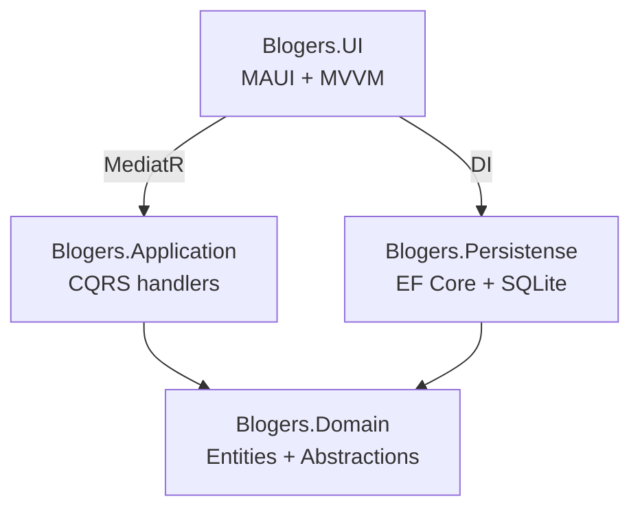

# Blogers & Stories

## Название и назначение

**Blogers & Stories** — кроссплатформенное приложение для ведения базы блогеров
и их публикаций (историй). Позволяет добавлять, редактировать и удалять блогеров,
вести список их историй, привязывать к историям изображения и визуально выделять
популярные публикации.

## Целевые пользователи

- **Контент-менеджер / SMM-специалист** — ведёт учёт блогеров и их публикаций.
- **Владелец небольшого агентства** — хранит базу инфлюенсеров для работы с рекламой.
- **Студент / разработчик** — использует проект как учебный пример Clean Architecture + MAUI.

## Стек технологий

| Компонент | Технология |
|---|---|
| Язык | C# (.NET 10) |
| UI | .NET MAUI (Windows, Android) |
| Архитектура | Clean Architecture + MVVM + CQRS |
| ORM | Entity Framework Core |
| СУБД | SQLite |
| Медиатор | MediatR |
| MVVM | CommunityToolkit.Mvvm |
| UI-компоненты | CommunityToolkit.Maui |
| Тестирование | xUnit, Moq, FluentAssertions, Coverlet, ReportGenerator |

## Архитектура

Проект построен по Clean Architecture и разделён на 4 слоя. Зависимости направлены
«внутрь»: UI → Application → Domain, Persistence → Domain.



### Перечень модулей

| Модуль | Ответственность |
|---|---|
| `Blogers.Domain` | Сущности (`Bloger`, `Story`, `Person`, `Entity`), `StoryStatus`, интерфейсы `IRepository<T>`, `IUnitOfWork` |
| `Blogers.Application` | Бизнес-логика: CQRS-команды и запросы (MediatR), `DbInitializer` с seed-данными, регистрация MediatR |
| `Blogers.Persistense` | Работа с БД: `AppDbContext`, `EfRepository<T>`, `EfUnitOfWork`, Fake-реализации, регистрация DI |
| `Blogers.UI` | MAUI-приложение: страницы (XAML), ViewModels, конвертеры, Shell-навигация, композиция DI |
| `Blogers.Tests` | Юнит-, интеграционные и сценарные тесты, оценка покрытия |

## Точки интеграции

| Точка | Описание |
|---|---|
| **Файловая БД SQLite** | `{FileSystem.AppDataDirectory}/Blogers.db`, строка подключения в `appsettings.json` |
| **Локальное хранилище изображений** | `{FileSystem.AppDataDirectory}/Images/{storyId}.jpg` — фото историй |
| **Файл конфигурации** | `Blogers.UI.appsettings.json` (EmbeddedResource), секция `ConnectionStrings:SqliteConnection` |
| **Файловая система устройства** | `FilePicker.PickAsync` для выбора изображения пользователем |

Внешние HTTP-сервисы не используются.

## Сборка и запуск

### Требования
- .NET SDK 10.0+
- Для Android: Android SDK + эмулятор/устройство
- Для Windows: Windows 10 19041+

### Восстановление зависимостей
```
dotnet restore
```

### Сборка для Windows
```
dotnet build -f net10.0-windows10.0.19041.0
```

### Сборка для Android
```
dotnet build -f net10.0-android
```

### Запуск
```
dotnet run --project Blogers.UI
```

### Запуск тестов
```
dotnet test
```

## Основной функционал

**Блогеры**
- Просмотр списка всех блогеров
- Добавление блогера (имя, дата рождения, никнейм, число подписчиков)
- Редактирование блогера
- Удаление блогера

**Истории**
- Просмотр списка историй выбранного блогера
- Добавление истории (описание, лайки, просмотры, изображение)
- Редактирование истории
- Удаление истории
- Привязка изображения к истории

**Дополнительно**
- Подсветка историй по количеству лайков
- Жизненный цикл истории: `Draft → Published → Archived` (см. `docs/state-diagram.md`)
- Shell-навигация между страницами

## Тестирование

Проект покрыт сценарными, интеграционными и юнит-тестами.
Покрытие кода — **100%**.

### Запуск тестов

```
dotnet test
```

### Оценка покрытия

```
dotnet test --collect:"XPlat Code Coverage" --settings ./coverage.runsettings --results-directory ./TestResults
reportgenerator -reports:./TestResults/**/coverage.cobertura.xml -targetdir:./CoverageReport -reporttypes:Html
```

HTML-отчёт: `CoverageReport/index.html`. Целевое покрытие — не ниже 70%.

### Структура тестов

| Папка | Что тестируется |
|---|---|
| `Domain/` | Сущности `Bloger`, `Story`, переходы состояний |
| `Application/` | CQRS-хендлеры с моками `IUnitOfWork` |
| `Integration/` | Репозитории на SQLite in-memory |
| `Scenarios/` | Полные сценарии жизненного цикла Story |

### Применённые практики

- **AAA** (Arrange–Act–Assert) в каждом тесте
- **Параметризация** через `[Theory]` / `[InlineData]` для граничных случаев
- **Негативные тесты** — исключения, некорректный ввод, null
- **Моки** — Moq для изоляции `IUnitOfWork`
- **Независимость** — каждый тест создаёт собственные данные; интеграционные используют отдельное SQLite in-memory подключение с `IDisposable`

### Примечание

Заглушки HTTP-запросов не применяются: приложение не имеет внешних HTTP-интеграций
(полностью офлайн, SQLite). Все интеграционные тесты работают с реальной SQLite in-memory.

## Документация

- [`docs/requirements.md`](docs/requirements.md) — спецификация требований
- [`docs/state-diagram.md`](docs/state-diagram.md) — диаграмма состояний истории
- [`ISSUES.md`](ISSUES.md) — журнал дефектов